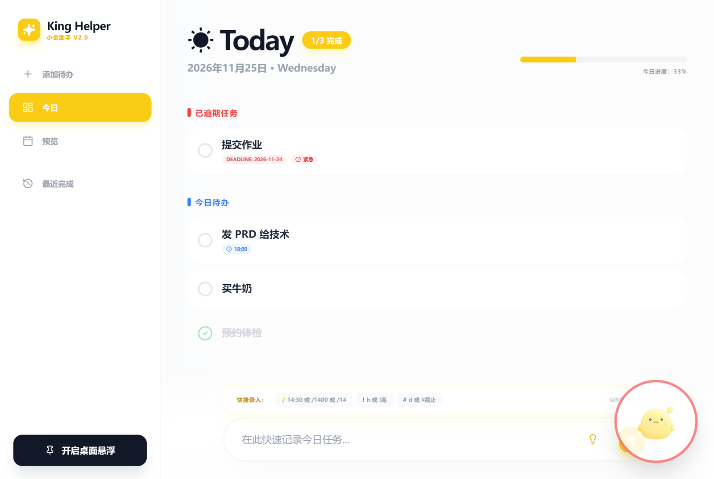
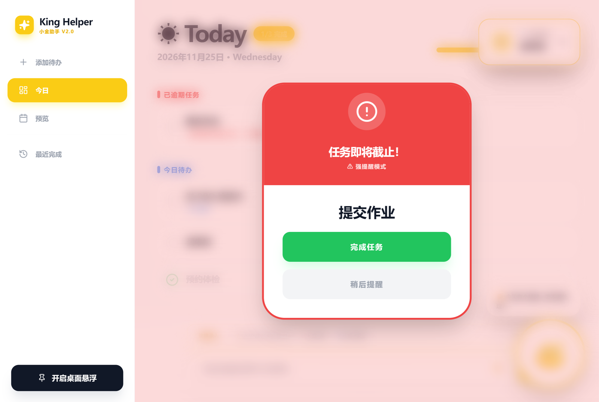
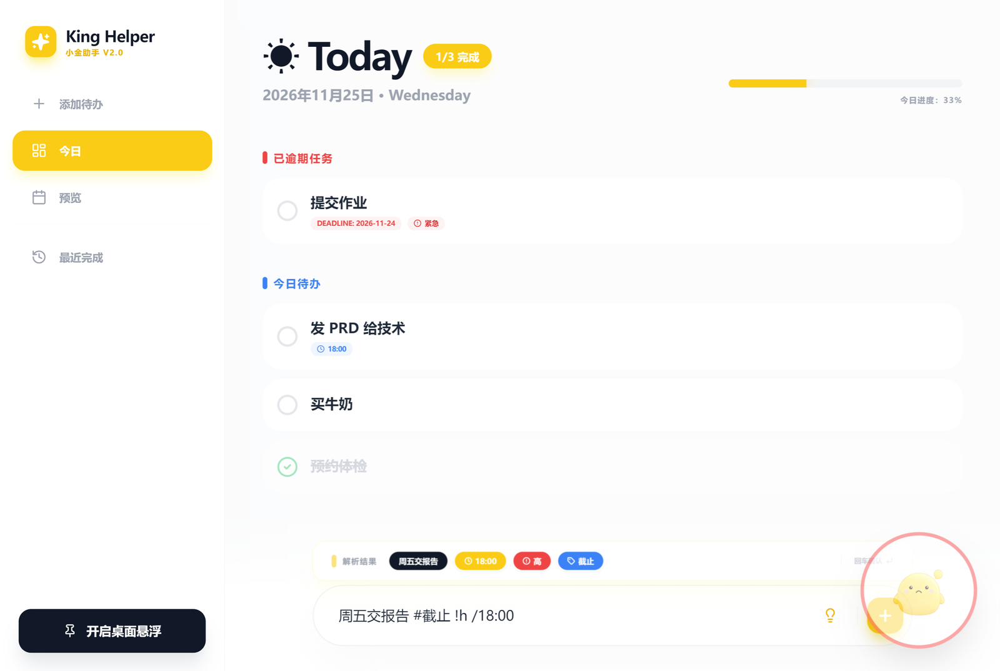
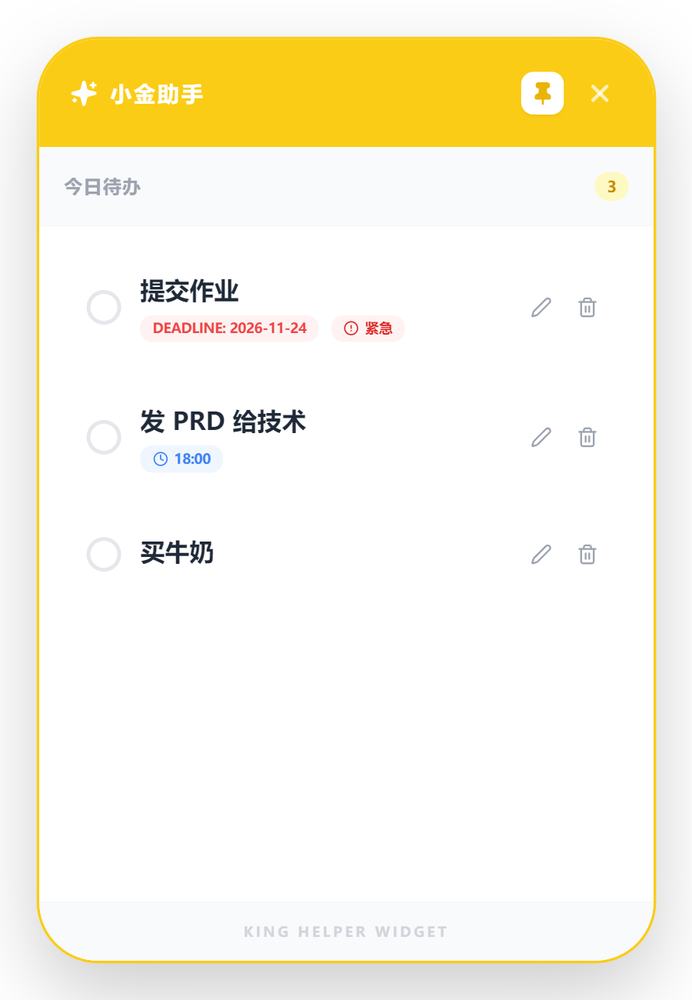
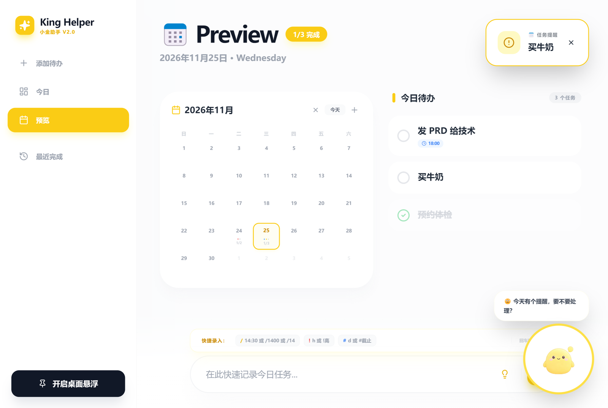
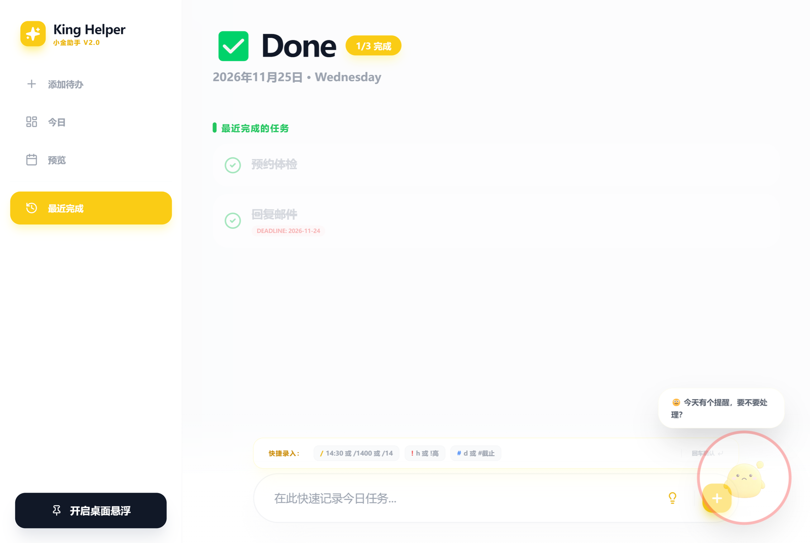
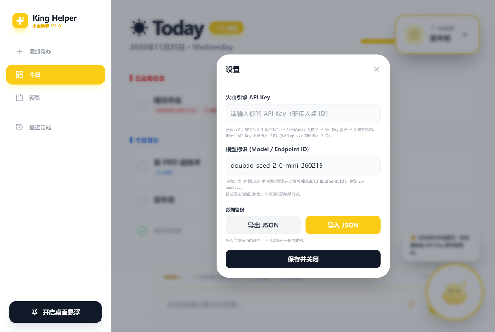

<div align="center">
  

  <h1>小金助手 · King Helper</h1>

  <p><b>一个小金人守在桌面角落，替你记住所有事。</b></p>

  <p>Windows 桌面待办 ｜ AI 一句话拆任务 ｜ 可置顶悬浮清单 ｜ 数据只存本地</p>

  <p>
    
    
    
    
  </p>
</div>

[下载安装包](https://github.com/wuyuanxin313/king-helper/releases) · [演示视频](https://www.bilibili.com/video/BV1hP17zYEGb/) · [功能](#功能) · [快速开始](#快速开始) · [反馈问题](https://github.com/wuyuanxin313/king-helper/issues)



---

## 它是什么

小金助手是一个跑在 Windows 上的个人待办工具。它不追求功能大而全，只解决三件事：

1. **记一件事不该超过三秒** —— 输入框敲一句话，回车即成任务；
2. **想不清楚的事交给 AI** —— 一整段自然语言，拆成结构化的多条任务；
3. **待办要看得见才会被做** —— 可置顶的悬浮清单，加一个会跟着状态变脸的小金人。

任务数据保存在本机，不需要注册账号。

---

## 功能

### 一句话，拆成多条任务

在「AI 智能排程」里输入一整段自然语言，比如：

> 明天下午三点开会，提醒我周五前交报告，然后今晚买牛奶

AI 会拆成三条任务，并把类型、日期、时间、优先级一次填好，确认后入库。


> 需要自备火山引擎方舟（Ark）的 API Key，详见 [AI 配置](#ai-配置)。不配置也能正常使用其它全部功能。

### 三种任务类型，三套提醒逻辑

| 类型 | 适合 | 提醒方式 |
| --- | --- | --- |
| 🚩 截止 Deadline | 有最后期限的事 | 到期前提醒、当天强化提醒、逾期持续标记 |
| 📅 日程 Scheduled | 有明确时间点的事 | 到点提醒 + 当天日程清单 |
| 🔔 提醒 Reminder | 做一次就够的小事 | 当天轻提醒 |

重要任务会触发**强提醒**：全屏置顶弹窗 + 常驻系统通知，必须处理或主动「稍后提醒」。



### 快捷输入

熟练之后，一条任务可以只按三次键。在主界面输入框里支持这些标签：

| 写法 | 含义 |
| --- | --- |
| `/14:30`、`/1400`、`/14` | 指定时间 |
| `#截止`、`#日程`、`#提醒`（或 `#d` `#s` `#r`） | 指定任务类型 |
| `!h`、`!m`、`!l`（或 `!高` `!中` `!低`） | 指定优先级 |

例如 `周五交报告 #截止 !h /18:00`，输入时就会实时解析成标签预览：



### 桌面悬浮清单

点左下角「开启桌面悬浮」，会弹出一个无边框、可置顶、可拖动的小窗：

- 不占任务栏，随时勾选
- 支持置顶开关、编辑、删除
- 尺寸可调整



### 预览与回顾

「预览」按月展示任务分布，有任务的日子会带小圆点；「最近完成」保留已完成清单，方便回头确认。





### 小金人 IP

主界面右下角的小金人会根据当前状态切换形态：

| 状态 | 表现 |
| --- | --- |
| 待机 | 平时形态，轻微互动 |
| 提醒 | 有临期任务时切换 |
| 紧急 | 有逾期任务时切换，带警示描边 |
| 完成 | 刚完成任务时切换 |

交互方式：

- **悬停**：冒出气泡，说一句话
- **单击**：显示当前提示
- **双击**：直接打开 AI 排程
- **Shift + 单击**：打开设置

### 数据备份

设置页支持导出 / 导入 JSON：

- 导出：生成 `king-helper-tasks-YYYYMMDD-HHmm.json`
- 导入：覆盖当前数据，并自动在本机留存一份备份（`king-helper-tasks-backup`）



---

## 快速开始

### 直接安装

1. 到 [Releases](https://github.com/wuyuanxin313/king-helper/releases) 下载最新的 `Setup.x.x.x.exe` 安装包
2. 双击安装，首次启动会创建桌面快捷方式
3. 打开即用，无需账号

> 目前只提供 Windows 安装包。不想安装的话，先看 [1 分钟演示视频](https://www.bilibili.com/video/BV1hP17zYEGb/)。

### 从源码运行

```bash
npm install
npm run dev      # Vite + Electron 开发模式
npm run build    # 打包 Windows 安装包
```

打包产物在 `dist-release2/`。

---

## AI 配置

AI 排程依赖火山引擎方舟（Ark）的大模型接口，需要你自己的 API Key：

1. 登录 [火山引擎控制台](https://console.volcengine.com/ark)
2. 进入「方舟 / 大模型」→「API Key 管理」→ 创建并复制
3. 打开小金助手 → 设置（左下角小金人 Shift + 单击）→ 粘贴 API Key → 保存

注意：

- **API Key 不是接入点 ID**（形如 `ep-xxx` 的是接入点 ID）
- 模型标识当前固定为 `doubao-seed-2-0-mini-260215`，暂不支持在界面切换
- AI 请求由 Electron 主进程转发，避免浏览器跨域限制；Key 只保存在本机

---

## 数据与隐私

- 任务数据保存在本机 `localStorage`（键名 `king-helper-tasks`），不经过任何服务器
- 不上传、不注册、不做账号体系
- 唯一会外发的数据：使用 AI 排程时，你输入的那段文字会发送到火山引擎用于解析
- 换电脑 / 备份：设置页导出 JSON，再在新设备导入

---

## 技术栈

| 层 | 选型 |
| --- | --- |
| 桌面壳 | Electron 32 |
| 界面 | React 18 + TypeScript |
| 构建 | Vite 5 + vite-plugin-electron |
| 样式 | Tailwind CSS 3 |
| 时间处理 | date-fns |
| 图标 | lucide-react |
| 打包 | electron-builder（NSIS） |

### 项目结构

```
king-helper/
├─ electron/
│  ├─ main.ts          # 主窗口、悬浮窗、AI 请求代理、IPC
│  └─ preload.ts       # 安全暴露 ipcRenderer
├─ src/
│  ├─ App.tsx          # 主界面、任务状态、提醒逻辑、IP 状态机
│  ├─ main.tsx
│  └─ index.css
├─ public/
│  └─ ip-pictures/     # 小金人五种状态图
└─ build/              # 打包图标
```

---

## 反馈

遇到问题或有想法，欢迎提 [Issue](https://github.com/wuyuanxin313/king-helper/issues)。如果这个工具对你有用，点个 Star 就是最好的鼓励。

## 许可

本项目暂未指定开源许可协议。
